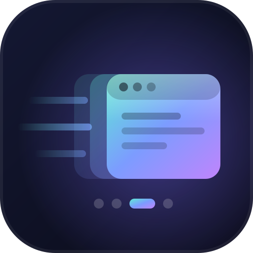
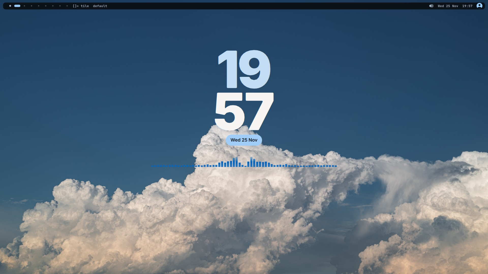
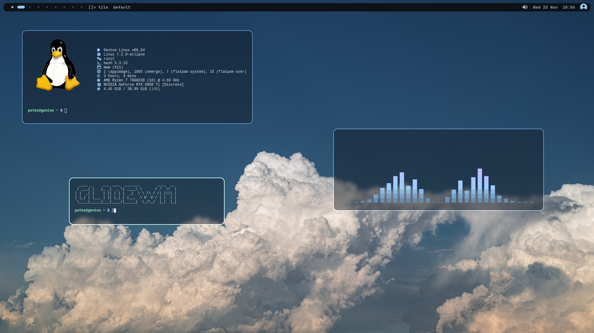
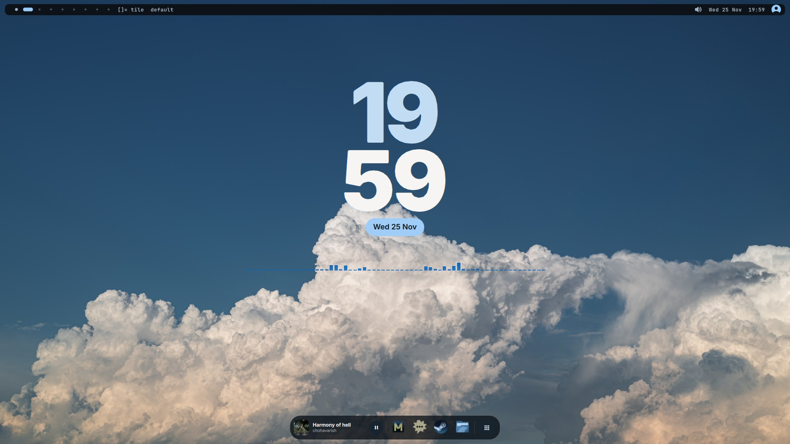

<div align="center">

<picture>
  <source media="(prefers-color-scheme: dark)" srcset="logo/glidewm-light.svg">
  
</picture>

**glide window manager**

A tiling window manager for X11, forked from [dwm](https://dwm.suckless.org) 6.8.<br>
Glass bar · smooth animations · infinite canvas · tiny IPC · one C file.

<br>

[](LICENSE)
[](dwm.c)
[](https://git.suckless.org/dwm)
[](https://github.com/petkebtw/glidewm/commits/main)
[](https://github.com/petkebtw/glidewm/stargazers)

<br>

[✨ Features](#-features) · [🎨 Rice](#-the-rice) · [📦 Install](#-install) · [⌨️ Keys](#️-keys) · [🔧 Setup](#-session-setup) · [🛠️ Troubleshooting](#️-troubleshooting) · [❓ FAQ](#-faq) · [🧵 Patches](#-patches)

<br>

 

</div>

> [!NOTE]
> glidewm is a personal fork of dwm. It is not an official suckless project.

## ✨ Features

**🎞️ Look and motion**
- Floating rounded bar. Padding drops when a tag holds one window.
- Tags are dots that ease into a pill.
- Windows move on a bezier curve (0.22 s). New windows are not animated.
- Smooth at high refresh rates: tag slides and shell menus run at the full 165 Hz (measured; see [Troubleshooting](#️-troubleshooting) for NVIDIA).
- Border on the focused window only, with a crossfade.
- Colours from X resources (`dwm.normbgcolor` ...). Reload: `Mod+F5`.

**📐 Layouts** · `Mod+space` cycles, `Mod+Ctrl+space` resets

| | Layout | |
| :---: | --- | --- |
| `[]=` | tile | master and stack |
| `[B]` | bento | big window left, uneven grid right |
| `[D]` | dock | sidebar, main area, widget column |
| `[#]` | mosaic | staggered brick rows |

**🌌 Canvas mode**
- `Mod+Shift+g` turns a tag into an infinite plane.
- Drag the background to pan. `Mod+scroll` zooms. `Mod+Ctrl+0` resets.

**🖥️ Multi-monitor**
- Systray mirrored on every bar, clicks included.
- New windows, popups and screenshots follow the pointer.
- Tag state published for external shells.

**🔌 Rice hooks**
- `~/.config/rice/binds.conf` replaces compiled keys at runtime.
- Quickshell panels are mapped but never tiled.
- Root-property [IPC](#-ipc).

📖 Full reference: [docs/dwm-features.md](docs/dwm-features.md)

<div align="center">

<br><sub>An empty tag: clock and visualiser widgets, colours taken from the wallpaper.</sub>
</div>

## 🎨 The rice

The screenshots show glidewm with a full desktop shell on top. It lives in [`rice/`](rice). glidewm runs fine without it.

**🖌️ Themes from the wallpaper**
- Accent colour picked from the wallpaper. Grey pictures stay grey.
- One apply themes the bar, rofi, Konsole, kitty, btop, cava, fastfetch, Qt, SDDM and the shell.
- Contrast guard keeps text readable (WCAG).
- Fonts and styles follow the palette mood: Material 3, macOS, Brutal, Wallpaper.
- `theme-switch` (`Mod+Shift+t`): arrows to preview, Enter keeps, Esc reverts.

<div align="center">

<br><sub>Floating terminals: fastfetch with the Tux logo from the logo gallery, a figlet banner and cava. Every colour comes from the wallpaper.</sub>
</div>

**🧩 Shell (Quickshell QML)**
- Bar, dock, control centre (`Mod+n`) and dynamic island. Based on [DarkShadow's Shell](https://github.com/shadowww-dev/DarkShadowShell), ported to X11.
- Dock: slides in from the bottom edge, a dot under every open app, a click on an open app slides to its tag.
- Hover a tag on the bar: a card lists the apps on that tag.
- Desktop widgets: clock, visualiser, weather, battery, lyrics. `Mod+e` edits them.
- Game bar (`Mod+g`), hot corner, welcome screen, wallpaper picker.
- Menus grow out of the bar as glass shapes.
- Screenshot, record and lock in the shell run the glidewm tools (`rice-shot`, `rice-record`, `rice-lock`).
- 🔄 **Update Center** (Shell Settings): pulls glidewm and the newest shell, rebuilds it for X11, rolls back if a patch no longer fits.

<div align="center">

<br><sub>The dock: now playing, pinned apps, app grid. It hides when a window covers it.</sub>
</div>

**🔎 Launcher and tools**
- Search apps, files, settings, math. Prefixes: `>` terminal, `?` web, `=` math, `/` paths.
- Clipboard history (`Mod+v`) and media card (`Mod+Shift+m`).
- Tools menu: convert, download, record, screenshot, colour picker, QR code.
- Screenshot editor with OCR. Screen recorder with per-app audio.
- Lock screen, power menu, polkit prompt, SDDM theme.

**⚙️ Settings** (`Mod+o`)
- Shell Settings: look, widgets, notifications, wallpapers, updates. Options that only work on Hyprland or niri are hidden.
- Its **glidewm** page opens the glidewm settings app: display, keyboard and mouse, gaps, shortcuts, network, sound devices.

**🖼️ Wallpapers**
- Screenshots, icons and small or tall pictures are not listed as wallpapers.
- Duplicates (same picture, other name, folder or size) are listed once, the best quality copy.
- Picking one anywhere (Settings, picker, theme switcher) themes the whole desktop from it.

**🪄 Compositor**
- [picom](https://github.com/yshui/picom) 13 rules: clean menus, no blur on widgets, light blur on moving windows.

## 📦 Install

### ⚡ One command

```sh
git clone https://github.com/petkebtw/glidewm.git && cd glidewm
./install.sh --check     # what is installed, what is missing (with the package names for your distro)
./install.sh             # pick the parts (arrow keys, Space, Enter on Submit), then install
```

```
Choose what to install
 ❯ [x] glidewm               build, sudo make install -> /usr/local/bin/glidewm
   [x] Rice              rice-* helpers, Python library, picom/rofi/keys configs, ~/.xprofile
   [x] Shell             Quickshell: widgets, control centre, launcher, settings, lock
   [x] Login session     "glidewm" at the SDDM / LightDM / GDM login, ~/.xinitrc for startx (sudo)
   [x] App menu entries  Settings, Theme Switcher, Screenshot, Recorder ... in your app launcher

   Submit
 ↑/↓ move · Space toggle · Enter select · a all · n none · Esc quit
```

- 🔍 **Checks first:** every dependency (build, rice, shell, optional) with the install command for Gentoo, Arch, Debian or Fedora. A part whose dependencies are missing starts unselected and shows what is missing; choosing it anyway stops with an error that names the packages to install.
- ⚙️ **Init system:** systemd, OpenRC, runit, s6 or dinit. It checks logind/elogind, polkit, D-Bus, how PipeWire starts and which display manager starts at boot (and how to enable one).
- 👯 **Duplicates:** a second glidewm login entry, an old install under the name `dwm`, helpers shadowed in `PATH`, things `~/.xprofile` starts twice, picom or the shell running twice.
- 🔗 **Parts that need each other switch together:** Shell and App menu entries need Rice, Login session needs glidewm (unless it is already installed). Turning one off turns off what needs it.
- 🤫 **Quiet:** only warnings (`!`) and errors (`✘`) are printed; `--verbose` also shows what is fine and every step done.
- 🛡️ **Safe:** never overwrites your files; existing ones are kept or backed up (`*.bak-DATE`).
- 🤖 **Scripted:** `--only=rice,shell` (no menu), `--yes`, `--dry-run` (prints every step), `--no-build` / `--no-rice` / `--no-shell` / `--no-session` / `--no-apps`.
- 🚪 Then log out and pick **glidewm** at the login screen, or `startx`.

The manual steps follow.

### 1. Dependencies

| Distro | Command |
| --- | --- |
| 🐧 Gentoo | `emerge x11-libs/libX11 x11-libs/libXft x11-libs/libXinerama x11-libs/libXtst x11-libs/libXext x11-libs/cairo media-libs/fontconfig` |
| 🌀 Debian / Ubuntu | `apt install build-essential pkg-config libx11-dev libxft-dev libxinerama-dev libxtst-dev libxext-dev libcairo2-dev libfontconfig1-dev` |
| 🏔️ Arch | `pacman -S base-devel libx11 libxft libxinerama libxtst libxext cairo fontconfig` |

Required at runtime: `xrdb` and a terminal (default `konsole`, change `termcmd` in `config.h`).

<details>
<summary>Optional runtime tools</summary>

| Tool | For |
| --- | --- |
| `picom` | blur, shadows, rounded corners |
| `feh` | wallpaper |
| `pipewire`, `wireplumber` | audio |
| `quickshell` (X11 build) | widgets, dock, launcher |
| `xdotool`, `maim`, `xclip` | scripting, screenshots, clipboard |
| a polkit agent | auth prompts |
| JetBrains Mono, Symbols Nerd Font | bar font |

</details>

### 2. Build glidewm

```sh
git clone https://github.com/petkebtw/glidewm.git
cd glidewm
cp config.def.h config.h     # edit to taste
make
sudo make install            # installs /usr/local/bin/glidewm (a system dwm is not touched)
```

Add `exec glidewm` to `~/.xinitrc`, or pick the session in your display manager (`install.sh` adds the "glidewm" entry).

> [!IMPORTANT]
> Default binds call the `rice/` helpers (`rice-search`, `rice-center`, `dwm-volume` ...).
> Install the rice, or change the binds in `config.h` or `~/.config/rice/binds.conf`.

### 3. Install the rice (optional)

```sh
cd rice && ./install.sh                  # symlinks, never overwrites
cp config/xprofile.example ~/.xprofile   # edit monitors, wallpaper, layout
~/.local/share/dss/port.sh               # build the Quickshell shell
~/.local/share/dss/dss-start             # start it
```

- Needs Python 3, PyGObject (GTK 3), Pillow, `rofi`, `picom`, `feh`, `xdotool`, `maim`, `xclip`, `tesseract`, `ffmpeg`.
- Quickshell must be built for X11 (Gentoo: `gui-apps/quickshell` with `X`, without `layer-shell`).
- Or let `../install.sh` do all of it.
- `rice-dl` needs a [cobalt](https://github.com/imputnet/cobalt) URL in `~/.cache/rice/cobalt_url`.

<details>
<summary>📁 What is in <code>rice/</code></summary>

| Path | Contents |
| --- | --- |
| `bin/` | 50 commands: `rice-*`, `theme-switch`, `scglass`, `dwm-status`, `dwm-volume`, `rofi-launcher` ... |
| `lib/` | shared Python: themes, designs, per-app hooks, widgets, settings |
| `shell/` | `port.sh`, `dss-start`, X11 patches for the shell |
| `shell/dss/` | the QML shell: desktop, apps, settings, lock screen, welcome, sounds |
| `config/` | picom `rice.conf`, `binds.conf`, rofi themes, `xprofile.example` |

</details>

## ⌨️ Keys

`Mod` = `Alt`

<table>
<tr><td valign="top">

**🚀 Apps**

| Keys | Action |
| --- | --- |
| `Mod+Shift+Return` | terminal |
| `Mod+p` | launcher |
| `Mod+s` | search |
| `Mod+n` | control centre |
| `Mod+o` | settings |
| `Mod+v` | clipboard |
| `Mod+z` | monitor overview |
| `Mod+g` | game bar |
| `Mod+Shift+t` | themes |
| `Mod+Shift+o` | tools |
| `Mod+Shift+m` | media |
| `Mod+Shift+r` | recorder |
| `Mod+Shift+s` / `Print` | screenshot |
| `Mod+Shift+l` | lock |
| `Mod+e` / `Mod+Shift+e` | edit / add widgets |

</td><td valign="top">

**🪟 Windows**

| Keys | Action |
| --- | --- |
| `Mod+j` / `k` | focus next / prev |
| `Mod+Shift+j` / `k` | move down / up |
| `Mod+Return` | to master |
| `Mod+h` / `l` | master size |
| `Mod+i` / `d` | master count |
| `Mod+Shift+space` | float |
| `Mod+Arrows` | snap |
| `Mod+Shift+Arrows` | nudge |
| `Mod+Ctrl+Arrows` | resize |
| `Mod+Shift+c` | close |
| `Mod+space` | next layout |
| `Mod+t` | tile |
| `Mod+-` / `=` | gaps |
| `Mod+b` | toggle bar |

</td><td valign="top">

**🏷️ Tags and session**

| Keys | Action |
| --- | --- |
| `Mod+1..9` | view tag |
| `Mod+Shift+1..9` | send to tag |
| `Mod+0` | all tags |
| `Mod+Shift+0` | sticky window |
| `Mod+,` / `.` | focus monitor |
| `Mod+Shift+,` / `.` | send to monitor |
| `Mod+Shift+g` | canvas mode |
| `Mod+scroll` | canvas zoom |
| `Mod+Ctrl+0` | reset zoom |
| `Mod+F5` | reload colours |
| volume keys | volume |
| `Mod+Shift+q` | quit |
| `Mod+Ctrl+Shift+q` | restart, keep windows |

</td></tr>
</table>

## 🔧 Session setup

Put this in `~/.xprofile` (SDDM, GDM, LightDM) or at the top of `~/.xinitrc`:

```sh
export PATH="$HOME/.local/bin:$PATH"
xrandr --output DP-1 --primary --mode 1920x1080 --pos 0x1080 \
       --output HDMI-1 --mode 1920x1080 --pos 0x0
xrdb -merge ~/.Xresources
feh --bg-fill ~/Pictures/wall.jpg &
picom --config ~/.config/picom/picom.conf &
setxkbmap us
xset s off; xset s noblank; xset -dpms
(sleep 2; pipewire-pulse) &
```

- 💡 Start `picom` before `quickshell`, so panels get blur.
- 💡 Two NVIDIA monitors with different refresh rates: `__GL_SYNC_DISPLAY_DEVICE=<fast output> picom ...`

## 📡 IPC

```sh
xprop -root -f _RICE_CMD 32c -set _RICE_CMD "2, 12"    # set the gap to 12 px
```

- Wait about 40 ms between writes, or the second is lost.
- State is published on `_RICE_TAGS` and `_RICE_MONS`.
- Command list: [docs/dwm-features.md](docs/dwm-features.md).

## 🛠️ Troubleshooting

| Problem | Fix |
| --- | --- |
| Wrong colours or blur | `rice-themecheck --fix` |
| A script crashed | see `~/.cache/rice/crash.log` |
| Menu leaves a ghost | reload picom: `kill -USR1 <picom pid>` |
| Animations feel heavy | Settings > Appearance, or lighter blur |
| NVIDIA, two monitors: menus and apps stuck near 75 fps | `export __GL_SYNC_DISPLAY_DEVICE=<fast output>` in `~/.xprofile` (OpenGL syncs to the slow monitor otherwise) |
| Everything tops out near half the refresh rate | picom `vsync = false` in `rice.conf` (the default here: with `true` NVIDIA waits two vblanks a frame). Tearing? set it back to `true` |
| Tray on wrong monitor | set `systraypinning` in `config.h`, rebuild |
| `Mod+z`: "no data from dwm" | `sudo make install`, restart glidewm |
| No "glidewm" at the login screen | `./install.sh --only=session` |
| A setting does nothing | tell us: X11-only gaps are hidden by `rice/shell/patches/hide-dead.py` |
| Shell update failed | it rolled back; the log is in Shell Settings > Update Center |
| What is missing? | `./install.sh --check` |
| Key edits do nothing | delete `~/.config/rice/binds.conf` |
| Audio hangs | restart PipeWire |
| Stutter with a game | GPU load, not glidewm |

## ❓ FAQ

<details>
<summary><b>Do I need the rice or Quickshell?</b></summary>

No. glidewm runs without them.
</details>

<details>
<summary><b>Does it replace my dwm?</b></summary>

No. The binary is `glidewm` (`/usr/local/bin/glidewm`) and the login entry is "glidewm", so a system `dwm` keeps working next to it.
Colours are still read from `dwm.*` X resources, so existing `~/.Xresources` work.
</details>

<details>
<summary><b>How do I follow upstream dwm?</b></summary>

```sh
git remote add upstream https://git.suckless.org/dwm
git fetch upstream
```

Expect conflicts: `dwm.c` has diverged a lot.
</details>

## 🧵 Patches

glidewm is dwm 6.8 plus these patches. Only systray was applied from its diff; the others were written into `dwm.c` by hand (the code had moved too far for the diffs to apply) and some do more than the original.

| Patch | What it does here | How |
| --- | --- | --- |
| [systray](https://dwm.suckless.org/patches/systray/) | Tray icons in the bar | applied, then extended: mirrored on every monitor's bar, clicks included |
| [barpadding](https://dwm.suckless.org/patches/barpadding/) | Floating bar with gaps around it | by hand (`vertpad`, `sidepad`); padding drops when a tag holds one window |
| [fullgaps](https://dwm.suckless.org/patches/fullgaps/) | Gaps between windows, `Mod+-` / `Mod+=` | by hand (`gappx`, `setgaps`) |
| [movestack](https://dwm.suckless.org/patches/movestack/) | `Mod+Shift+j/k` moves a window in the stack | by hand |
| [cyclelayouts](https://dwm.suckless.org/patches/cyclelayouts/) | `Mod+space` cycles layouts | by hand (`cyclelayout`) |
| [xrdb](https://dwm.suckless.org/patches/xrdb/) | Colours from X resources, live reload | by hand (`loadxrdb`); also reloads when the resources change |
| [restartsig](https://dwm.suckless.org/patches/restartsig/) | Restart in place (`Mod+Ctrl+Shift+q`, `SIGHUP`) | by hand (`quit` with an argument) |
| [preserveonrestart](https://dwm.suckless.org/patches/preserveonrestart/) ([pdwm version](https://github.com/r0-zero/pdwm/blob/master/patches/dwm-6.3-patches/dwm-preserveonrestart-6.3.diff)) | Windows keep their tags **and monitor** across a restart | by hand; also every monitor's view and the selected monitor |

Written for glidewm (no patch): window and tag-slide animation, bento / dock / mosaic layouts, canvas mode with zoom, the root-property IPC, runtime key binds, shell window handling.

## 🙏 Credits

- [dwm](https://dwm.suckless.org) by suckless.org: the base.
- The authors of the [patches above](#-patches), from the [suckless patch archive](https://dwm.suckless.org/patches/), and [r0-zero/pdwm](https://github.com/r0-zero/pdwm) for preserveonrestart.
- [DarkShadow's Shell](https://github.com/shadowww-dev/DarkShadowShell) (MIT): the QML shell, ported to X11.
- [Quickshell](https://quickshell.org), [picom](https://github.com/yshui/picom), [cairo](https://www.cairographics.org).
- [fastfetch](https://github.com/fastfetch-cli/fastfetch), [cava](https://github.com/karlstav/cava), [rofi](https://github.com/davatorium/rofi), [Inter](https://rsms.me/inter/) (logo type) and [JetBrains Mono](https://www.jetbrains.com/lp/mono/) (bar font).
- Fastfetch logo gallery: public-domain portraits from [Wikimedia Commons](https://commons.wikimedia.org), Tux by Larry Ewing and The GIMP, the Gentoo logo (CC BY-SA 2.5).

## 📄 License

MIT/X, same as dwm. See [LICENSE](LICENSE). The shell in `rice/shell/dss` keeps its own MIT `LICENSE`.
