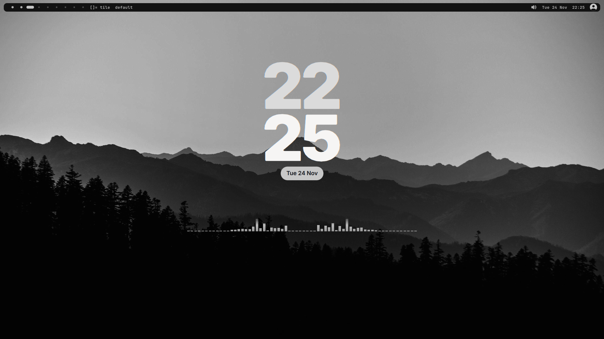
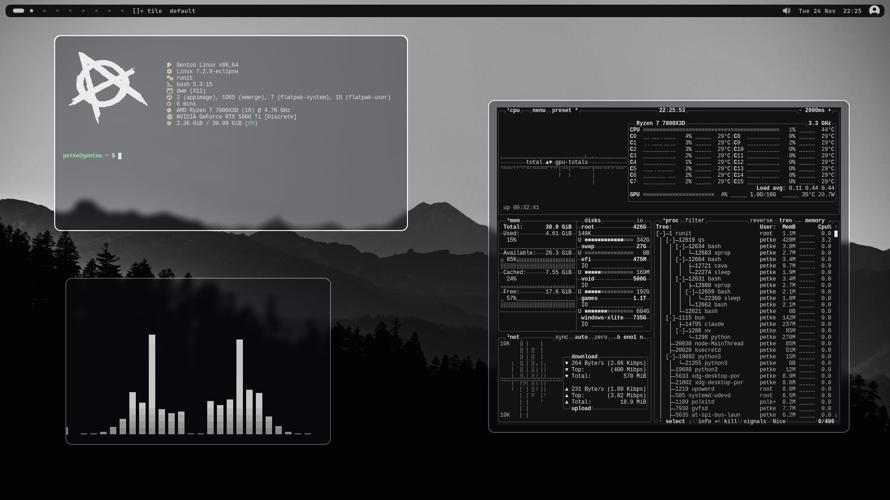

<div align="center">

# mwm

**muxy window manager**

A dynamic tiling window manager for X11, forked from [suckless dwm](https://dwm.suckless.org) 6.8.<br>
Floating glass bar, eased animations, an infinite canvas mode, and a small IPC. About one C file.

<br>

[](LICENSE)
[](dwm.c)
[](https://git.suckless.org/dwm)
[](https://github.com/petkebtw/mwm/commits/main)
[](https://github.com/petkebtw/mwm/stargazers)

<br>

[**Features**](#features) · [**Install**](#install) · [**Keys**](#keys) · [**Session setup**](#session-setup) · [**IPC**](#ipc) · [**FAQ**](#faq) · [**Credits**](#credits)

<br>

 

</div>

<br>

> [!NOTE]
> mwm is an independent fork of dwm. It is not an official suckless project.

## Why mwm

dwm is small and fast, and most of what makes it pleasant comes from patches you apply and
merge by hand. mwm ships that work done: a good-looking bar, smooth motion, and sensible
multi-monitor behaviour, still one readable C file, configured by editing `config.h`.

- **Still dwm.** Same model, same `config.h`, same compile-to-configure. If you know dwm you know mwm.
- **Looks first-class.** Rounded floating bar, dot and pill tags, eased window motion.
- **Made for rices.** Colours come from X resources, binds can be swapped at runtime, and an IPC lets a shell drive the WM.

## Features

<details open>
<summary><b>Look and motion</b></summary>

- Floating bar with padding and gaps. It drops the padding when a tag holds a single window.
- Tags drawn with cairo as dots that ease into a pill.
- Window animation on a cubic bezier (0.22 s). New windows are not animated, so a terminal always sees its final size.
- Border on the focused window only, with a crossfade between windows.
- Colours from X resources (`dwm.normbgcolor`, `dwm.selbgcolor` ...). Reload with `Mod+F5`.

</details>

<details open>
<summary><b>Layouts</b></summary>

| Symbol | Layout | What it does |
| :---: | --- | --- |
| `[]=` | tile | classic master and stack |
| `[B]` | bento | one hero window left, an uneven grid right |
| `[D]` | dock | sidebar, main area, widget column |
| `[#]` | mosaic | staggered brick rows |

`Mod+space` cycles through them. `Mod+Ctrl+space` goes back to tile. `Mod+Shift+space` floats one window.

</details>

<details open>
<summary><b>Canvas mode</b></summary>

`Mod+Shift+g` turns a tag into an infinite plane. Drag the background (or `Mod+Shift` and drag) to pan,
`Mod+scroll` to zoom. Press `Mod+Ctrl+0` to reset the zoom.

</details>

<details open>
<summary><b>Multi-monitor</b></summary>

- Systray on every bar. The real tray lives on one monitor and the other bars mirror it, clicks included.
- Spawns, popups and screenshots follow the pointer.
- Per-monitor tag state is published so an external shell can show it.

</details>

<details>
<summary><b>Window control without a mouse</b></summary>

`Mod+Arrows` snaps a window to half or quarter of the screen, `Mod+Shift+Arrows` nudges it 48 px, `Mod+Ctrl+Arrows` resizes it.
`Mod+Shift+j/k` moves a window up or down the stack. `Mod+Ctrl+Shift+q` restarts mwm and keeps your windows and tags.

</details>

<details>
<summary><b>Rice hooks</b></summary>

- `~/.config/rice/binds.conf` replaces the compiled `keys[]` when it exists. `dwm --dump-binds` prints the compiled set.
- Shell windows (Quickshell panels of dock and menu type) are mapped but never tiled.
- Root-property IPC, see [IPC](#ipc).

</details>

Full reference: [docs/dwm-features.md](docs/dwm-features.md).

## The rice

The screenshots show mwm with a full desktop shell on top. The shell is a set of Python/GTK helpers and a Quickshell QML
layer that talk to mwm through its keys and IPC. They live in [`rice/`](rice). mwm runs fine without them.

<details>
<summary><b>Theming from the wallpaper</b></summary>

- Every theme is a wallpaper. The accent is extracted in OKLab from a 64x64 copy: it picks the colourful hue the picture really has, muted pictures give muted accents, and grey pictures stay grey.
- One apply writes colours for the bar, rofi, Konsole, kitty, btop, cava, fastfetch, Qt, SDDM and the shell, then reloads picom.
- Contrast guard: text, accents and borders are pushed away from the background until they pass WCAG contrast.
- Fonts follow the mood of the palette: IBM Plex (serious), Inter or JetBrains (calm), Nunito (soft), Fraunces (elegant), Space Grotesk (techy), Fredoka (playful).
- Design styles: Wallpaper, Material 3 (tonal roles), macOS (system greys and blue, magnify dock), Brutal (black, white, hard edges).
- Wallpaper sources: `mono` (default: black and white, muted, ink), `wallhaven`, `minimal`, `both`, plus your own folder.
- `rice-themecheck` verifies that the live theme matches the wallpaper and repairs it with `--fix`.
- Glass mode: translucent blurred menus tinted by the wallpaper, or solid menus (near black, near white on bright wallpapers).

</details>

<details>
<summary><b>Launcher, search and tools</b></summary>

- Universal search: apps, files, settings, commands, a calculator and unit converter. Prefixes: `>` run in a terminal, `?` web, `=` math, `/` or `~` browse paths.
- Clipboard history with filter.
- Media card: art, title, artist, progress, previous, play, next.
- Tools menu: Convert (images, video, audio, archives), Download, Record, Screenshot, Colour picker, QR code, Themes, Settings, Media, Volume.
- Screenshot editor: per-monitor capture, zoom and pan, and OCR (English, German, French, Spanish, Hungarian, Russian).
- Screen recorder: audio output, per-app audio and mic.
- Lock screen, power menu, polkit prompt, and an SDDM login theme built from the wallpaper.

</details>

<details>
<summary><b>Shell: bar, dock, widgets, island</b></summary>

- Control centre (`Mod+n`): Control, Today, System and Style tabs. Style holds motion presets, dock options, bar options and the design picker.
- Dock: touch the bottom screen edge. Click opens or focuses, middle click opens a new window, right click pins. Magnify, autohide, per-monitor.
- Desktop widgets: clock (several styles), audio visualiser, weather, battery, lyrics and more. `Mod+e` edits them: drag, resize, nudge, glass or bare, add, remove. Right click a widget for font, design, accent and opacity.
- Widgets hide while windows are open on their monitor, through the compositor, so tag switches do not redraw them.
- Dynamic island over the bar: clock and weather when idle, equaliser and title when music plays, a media card on hover.
- Game bar: volume, mic, do-not-disturb, screenshot and record in one card.
- Hot corner, intro screen with a key cheat sheet, and a wallpaper picker.
- Menus grow out of the bar as a glass shape, then fade their contents in. Closing folds them back.

</details>

<details>
<summary><b>Settings app</b></summary>

Appearance (glass, scheme, animations, terminal opacity, blur, shadows), Wallpapers, Sound (volume, devices), Display
(resolution, refresh, orientation, brightness, night light, screen-off), Keyboard and Mouse, Windows and Bar (gaps),
Network (interfaces, DNS, MTU, DHCP renew, tests), Shortcuts (writes `~/.config/rice/binds.conf`) and About.

</details>

<details>
<summary><b>Compositor</b></summary>

Rules for [picom](https://github.com/yshui/picom) 13 keep menus, cards and widgets clean: no animation on ghost windows,
no blur or shadow on the shell widgets (it made every widget a block), lighter blur and no shadow on moving windows to
remove tag-switch stutter. Games get their own rule. On NVIDIA, sync the swap to the fast monitor.

</details>

## Install

### Dependencies

**Build:** a C99 compiler, `make`, `pkg-config`, and the dev headers for Xlib, Xft, fontconfig, Xinerama, Xext, XTest and cairo (xlib backend).

| Distro | Command |
| --- | --- |
| Gentoo | `emerge x11-libs/libX11 x11-libs/libXft x11-libs/libXinerama x11-libs/libXtst x11-libs/libXext x11-libs/cairo media-libs/fontconfig` |
| Debian / Ubuntu | `apt install build-essential pkg-config libx11-dev libxft-dev libxinerama-dev libxtst-dev libxext-dev libcairo2-dev libfontconfig1-dev` |
| Arch | `pacman -S base-devel libx11 libxft libxinerama libxtst libxext cairo fontconfig` |

**Runtime, required:** `xrdb` (colours) and a terminal. The default is `konsole`, change `termcmd` in `config.h`.

<details>
<summary><b>Runtime, optional</b></summary>

mwm does not start these. Your `~/.xprofile` does.

| Tool | Used for |
| --- | --- |
| [`picom`](https://github.com/yshui/picom) | blur, shadows, rounded corners. The bar is ARGB and wants a compositor. |
| `feh` | wallpaper |
| `pipewire`, `pipewire-pulse`, `wireplumber` | audio (`wpctl`, `pactl`) |
| [`quickshell`](https://quickshell.org) (X11 build) | widgets, dock, launcher |
| `xrandr`, `setxkbmap`, `xset` | monitors, keyboard, screen blanking |
| `xdotool`, `maim`, `xclip` | scripting, screenshots, clipboard |
| a polkit agent | auth prompts |
| JetBrains Mono, Symbols Nerd Font | bar font |

</details>

### Build

```sh
git clone https://github.com/petkebtw/mwm.git
cd mwm
cp config.def.h config.h     # edit to taste
make
sudo make install            # installs the binary to /usr/local/bin/dwm
```

Then add `exec dwm` to the end of `~/.xinitrc`, or pick the session in your display manager.

> [!IMPORTANT]
> The default binds call the helpers in [`rice/`](rice): `rice-search`, `rice-center`, `rice-map`, `rice-lock`, `rice-power`,
> `rice-media`, `rice-record`, `rice-settings`, `rice-gamebar` and `dwm-volume`. Install them (next section), or point the
> binds at your own commands in `config.h` or `~/.config/rice/binds.conf`.

### Install the rice (optional)

The whole desktop from the screenshots is in [`rice/`](rice):

| Path | What |
| --- | --- |
| `rice/bin` | 41 commands: `rice-*`, `dwm-status`, `dwm-volume`, `audio-fix`, `clip-daemon`, `polkit-agent`, `rofi-launcher`, `screenshot.sh` ... |
| `rice/lib` | the Python library they share: `themes.py` (palette), `designs.py`, `hooks.py` (per-app theme apply), `rice.py`, `widgets.py`, `settings.py` ... |
| `rice/shell` | `port.sh`, `dss-start`, `Wm.dwm.qml`, patches: builds DarkShadow's Shell for Quickshell on X11 |
| `rice/config` | `rice.conf` (picom), `binds.conf` (runtime keys), `xprofile.example` |

```sh
sudo emerge dev-python/pygobject x11-misc/rofi x11-misc/picom   # or your distro's equivalents
cd rice && ./install.sh          # symlinks into ~/.local/bin, ~/.local/lib/rice, ~/.config
cp config/xprofile.example ~/.xprofile   # then edit monitors, wallpaper, layout
```

Needs Python 3, PyGObject (GTK 3), `python-pillow`, cairo bindings, `rofi`, `picom`, `feh`, `xdotool`, `maim`, `xclip`, `pipewire` with
`wpctl`, `tesseract` (OCR) and `ffmpeg` (recorder, convert). The helpers need no build step.

The QML shell is DarkShadow's Shell, which is not copied here. Put its source in `~/.local/share/dss/src`, install
[Quickshell](https://quickshell.org) built for X11 (`gui-apps/quickshell` with `X`, without `layer-shell`), then run
`~/.local/share/dss/port.sh`. It rebuilds `~/.config/quickshell` from that source with the X11 and mwm changes applied.

`rice-dl` needs a [cobalt](https://github.com/imputnet/cobalt) API URL: put it in `~/.cache/rice/cobalt_url`.

## Keys

`Mod` is `Alt`.

| Keys | Action |
| --- | --- |
| `Mod+Shift+Return` | terminal |
| `Mod+p` | launcher |
| `Mod+s` | search |
| `Mod+n` | control centre |
| `Mod+o` | settings |
| `Mod+v` | clipboard history |
| `Mod+z` | zoomable overview of every monitor |
| `Mod+j` / `k` | focus next / previous |
| `Mod+h` / `l` | shrink / grow the master area |
| `Mod+i` / `d` | more / fewer master windows |
| `Mod+Return` | promote window to master |
| `Mod+space` | cycle layout |
| `Mod+Shift+space` | toggle floating |
| `Mod+1..9` | view tag |
| `Mod+Shift+1..9` | send window to tag |
| `Mod+,` / `.` | focus previous / next monitor |
| `Mod+Shift+,` / `.` | send window to previous / next monitor |
| `Mod+b` | toggle bar |
| `Mod+-` / `=` | gaps smaller / bigger |
| `Mod+Shift+c` | close window |
| `Mod+Shift+g` | canvas mode |
| `Mod+Shift+s` / `Print` | screenshot |
| `Mod+Shift+l` | lock |
| `Mod+F5` | reload colours from X resources |
| `Mod+e` / `Mod+Shift+e` | edit / add desktop widgets |
| `Mod+g` | game bar |
| `Mod+Shift+t` | theme switcher |
| `Mod+Shift+o` | tools menu |
| `Mod+Shift+m` | media card |
| `Mod+Shift+r` | screen recorder |
| `Mod+t` | tile layout |
| `Mod+Ctrl+space` | default layout |
| `Mod+0` / `Mod+Shift+0` | view all tags / show a window on all tags |
| `Mod+Arrows` | snap half or quarter |
| `Mod+Shift+Arrows` | nudge 48 px |
| `Mod+Ctrl+Arrows` | resize |
| `Mod+Shift+j` / `k` | move window down / up the stack |
| `Mod+scroll` | zoom the canvas (canvas mode) |
| `Mod+Ctrl+0` | reset canvas zoom |
| volume keys | volume up, down, mute (`dwm-volume`) |
| `Mod+Shift+q` | quit |
| `Mod+Ctrl+Shift+q` | restart, keep windows and tags |

## Session setup

Put session setup in `~/.xprofile` (SDDM, GDM and LightDM source it) or at the top of `~/.xinitrc`.

```sh
export PATH="$HOME/.local/bin:$PATH"

# monitors (names from `xrandr`)
xrandr --output DP-1 --primary --mode 1920x1080 --pos 0x1080 \
       --output HDMI-1 --mode 1920x1080 --pos 0x0

xrdb -merge ~/.Xresources            # dwm.normbgcolor, dwm.selbgcolor ...
feh --bg-fill ~/Pictures/wall.jpg &
picom --config ~/.config/picom/picom.conf &

setxkbmap us
xset s off; xset s noblank; xset -dpms

export XCURSOR_THEME=Adwaita XCURSOR_SIZE=24
export NO_AT_BRIDGE=1

(sleep 2; pipewire-pulse) &          # audio, after the session bus is up
```

- Run `xrdb -merge` before mwm starts. mwm also reloads colours when `RESOURCE_MANAGER` changes, or press `Mod+F5`.
- Start `picom` before `quickshell`, so panels get blur.
- Two NVIDIA monitors with different refresh rates: `__GL_SYNC_DISPLAY_DEVICE=<fast output> picom ...` keeps the fast one smooth.

## IPC

mwm listens on a root window property. Send commands with `xprop`:

```sh
xprop -root -f _RICE_CMD 32c -set _RICE_CMD "2, 12"    # set the gap to 12 px
```

Leave about 40 ms between two writes, or the second one is swallowed. The command set (view a tag, gaps,
canvas, monitor moves) is in [docs/dwm-features.md](docs/dwm-features.md). mwm publishes tag and monitor state
on `_RICE_TAGS` and `_RICE_MONS` for shells to read.

## Troubleshooting

| Symptom | Fix |
| --- | --- |
| Colours, blur or the terminal look wrong | `rice-themecheck --fix`. Log: `~/.cache/rice/themecheck.log` |
| A script crashed | `~/.cache/rice/crash.log` holds every traceback |
| A menu leaves a see-through ghost | check the picom rules, reload with `kill -USR1 <picom pid>` |
| Animations feel heavy | Settings > Appearance > Animations, or lighter blur in the picom config |
| The tray is on the wrong monitor | set `systraypinning` in `config.h` (1 = first, 2 = second) and rebuild |
| `Mod+z` says "no data from dwm" | the running binary is older than the build: `sudo make install`, then restart mwm |
| Keys do nothing after editing `keys[]` | `~/.config/rice/binds.conf` overrides them: delete it or reset in Settings > Shortcuts |
| Audio hangs | `wpctl` blocks when PipeWire is stale: restart PipeWire |
| Stutter with a game running | GPU load, not mwm. Close the heavy app, or move it to another monitor |

## FAQ

<details>
<summary><b>Is this an official suckless project?</b></summary>

No. It is a personal fork, built on the dwm 6.8 source. The suckless history is kept in the git log.

</details>

<details>
<summary><b>Do I need the rice scripts or Quickshell?</b></summary>

No. mwm runs without them. They provide the launcher, widgets and menus shown in the screenshots, and live in [`rice/`](rice).

</details>

<details>
<summary><b>How do I follow upstream dwm?</b></summary>

```sh
git remote add upstream https://git.suckless.org/dwm
git fetch upstream
```

Expect conflicts. `dwm.c` has diverged a lot.

</details>

<details>
<summary><b>Why is the binary called <code>dwm</code>?</b></summary>

The build still produces `dwm`, so existing session files and scripts keep working.

</details>

## Credits

- [dwm](https://dwm.suckless.org) by suckless.org: the base. Source at [git.suckless.org/dwm](https://git.suckless.org/dwm).
- [systray patch](https://dwm.suckless.org/patches/systray/): the tray, applied by hand and extended to mirror on every bar.
- [DarkShadow's Shell](https://github.com/shadowww-dev/DarkShadowShell): the QML widget, dock and launcher shell that the mwm setup runs through Quickshell on X11.
- [Quickshell](https://quickshell.org): the QML shell runtime.
- [picom](https://github.com/yshui/picom): compositor.
- [cairo](https://www.cairographics.org): bar drawing.

## License

MIT/X Consortium, the same as dwm. See [LICENSE](LICENSE). The original dwm copyright notices are kept.
